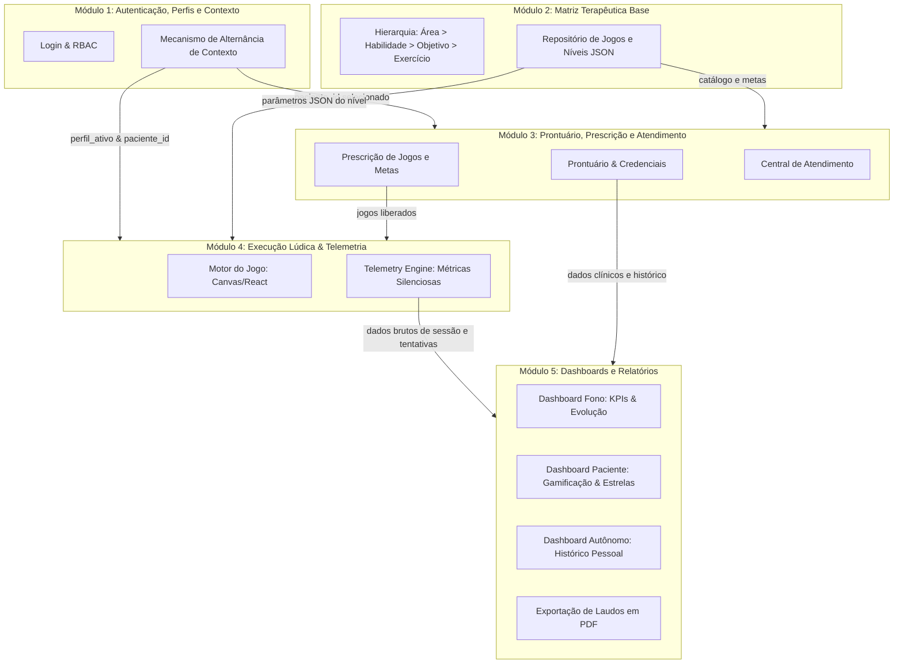

# Arquitetura e Módulos do Sistema — FonoGames

Este documento descreve a divisão modular, as responsabilidades de cada componente, as regras de negócio centrais (incluindo o mecanismo de **Context Switcher**) e os fluxos de integração da plataforma FonoGames.

---

## 1. Visão Geral da Arquitetura dos Módulos

---

## 2. Detalhamento dos Módulos

### Módulo 1: Autenticação, Perfis e Gestão de Contexto
- **Responsabilidades:** Cadastro, autenticação com token seguro, controle de acessos (RBAC) e controle de sessão ativa/contexto de uso.
- **Funcionalidades e Regras:**
  - **Fluxo de Login:** Login unificado por e-mail e senha. Redirecionamento automático por perfil (`ADMIN`, `FONOAUDIOLOGO`, `PACIENTE`, `AUTONOMO`).
  - **Gestão de Perfis:**
    - `ADMIN`: Gestão global de conteúdos e contas.
    - `FONOAUDIOLOGO`: Criação do perfil profissional + perfil individual de testes automático.
    - `PACIENTE`: Gerado obrigatoriamente pelo fonoaudiólogo com e-mail/senha.
    - `AUTONOMO`: Cadastro público e independente.
  - **Mecanismo de Alternância de Contexto (Context Switcher):**
    - O contexto padrão do fonoaudiólogo é o seu **próprio perfil de testes**.
    - Ao clicar em *"Selecionar Paciente"*, o estado global (ex: Context/Zustand no frontend e sessão no backend) armazena o `paciente_id` selecionado.
    - Enquanto o contexto estiver ativo, **todas as partidas jogadas no Módulo 4 gravam dados diretamente no prontuário do paciente** (origem `CLINICA_PRESENCIAL`).
    - Ao desmarcar o paciente, as partidas voltam a ser gravadas no perfil do profissional (origem `TESTE_PROFISSIONAL_AUTONOMO`).

---

### Módulo 2: Matriz Terapêutica Base (Conteúdo Clínico e Jogos)
- **Responsabilidades:** Integridade da árvore clínica e repositório central de atividades/jogos.
- **Funcionalidades e Regras:**
  - **Hierarquia Clínica:** `Área Terapêutica` $\rightarrow$ `Habilidade` $\rightarrow$ `Objetivo Terapêutico` $\rightarrow$ `Exercício`.
  - **Repositório de Jogos:**
    - Metadados: Título, mecânica (`MEMORIA`, `ASSOCIACAO`, `SEQUENCIA`), faixa etária e ícones.
    - Relacionamento N:N com exercícios via `JOGO_EXERCICIO` (um jogo atende múltiplos objetivos).
    - Configuração de dificuldade por fases (`NIVEIS`) usando schemas flexíveis em JSON, permitindo calibrar desafio sem refazer o motor do jogo.

---

### Módulo 3: Prontuário, Prescrição e Seleção de Paciente
- **Responsabilidades:** Gestão clínica dos pacientes, planos de tratamento e fluxo de atendimento no consultório.
- **Funcionalidades e Regras:**
  - **Cadastro de Paciente:** Registro dos dados do paciente e geração automática das credenciais de acesso para treino em casa.
  - **Prescrição / Plano Terapêutico:** Seleção de objetivos clínicos e liberação expressa de jogos específicos (`ATIVO`, `PAUSADO`, `CONCLUIDO`).
  - **Central de Atendimento:** Ativação do paciente no Context Switcher e consulta ao histórico completo de sessões.

---

### Módulo 4: Execução Lúdica de Jogos e Captura de Dados
- **Responsabilidades:** Renderização dos jogos (Canvas/React) e captura invisível de métricas de desempenho em tempo real.
- **Funcionalidades e Regras:**
  - **Motor do Jogo:** Carregamento dinâmico dos parâmetros JSON de cada nível.
  - **Validação de Permissão:**
    - Pacientes só conseguem abrir jogos liberados pelo seu plano ativo.
    - Fonoaudiólogos e Autônomos têm acesso liberado ao catálogo completo.
  - **Telemetry Engine:** Monitora em background sem interromper o jogo: acertos, erros, tempo decorrido, número de tentativas e taxa de acerto percentual.
  - **Persistência de Sessão:** Gravação imediata nas tabelas `SESSOES` e `TENTATIVAS_RESULTADOS` com a respectiva `origem`:
    - `CLINICA_PRESENCIAL`: Fono jogando com o paciente selecionado.
    - `CASA_REMOTO`: Paciente logado em casa.
    - `TESTE_PROFISSIONAL_AUTONOMO`: Fono testando jogo livremente ou usuário autônomo.

---

### Módulo 5: Dashboards de Desempenho e Relatórios
- **Responsabilidades:** Processar os dados das sessões e transformar métricas brutas em indicadores e laudos.
- **Funcionalidades e Regras:**
  - **Dashboard do Fonoaudiólogo:** KPIs clínicos gerais, linha do tempo de evolução por sessão (S1, S2, S3...) e comparativos por objetivo terapêutico.
  - **Dashboard do Paciente:** Visual lúdico, pontuações, medalhas e estrelas para incentivar engajamento infantil.
  - **Dashboard do Usuário Autônomo:** Métricas pessoais de tempo, recordes e evolução nas atividades.
  - **Exportação:** Geração de relatórios clínicos em PDF para acompanhamento médico e com os pais.

---

## 3. Regras de Negócio Críticas (RN)

| ID | Nome | Descrição |
|---|---|---|
| **RN01** | **Liberação e Vínculo Terapêutico** | Pacientes vinculados a um fonoaudiólogo só conseguem visualizar e jogar as atividades liberadas em seu plano ativo. |
| **RN02** | **Gravação por Contexto Ativo** | Toda partida jogada salva os dados diretamente no perfil que está ativo no momento (seja perfil do Fono, Paciente selecionado ou Usuário Autônomo). |
| **RN03** | **Perfil de Testes do Profissional** | Todo fonoaudiólogo recebe automaticamente um ambiente próprio para jogar e explorar jogos sem contaminar prontuários clínicos. |
| **RN04** | **Autonomia de Acesso do Paciente** | O paciente possui credenciais próprias para uso domiciliar criadas e controladas pelo seu fonoaudiólogo. |
