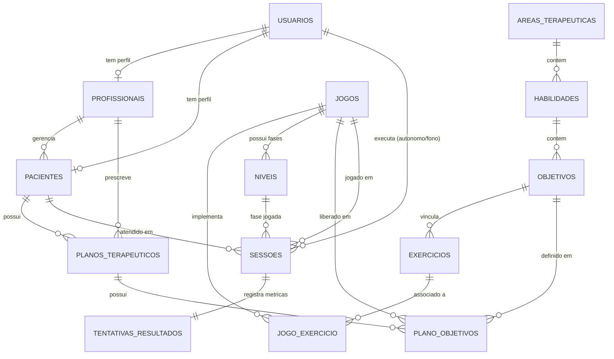

# Modelagem de Banco de Dados — FonoGames

Este documento descreve a modelagem relacional de dados da plataforma FonoGames, contendo as 14 tabelas principais, suas finalidades, estruturas de colunas, tipos de dados, chaves primárias, estrangeiras e regras de integridade referencial.

---

## 1. Visão Geral das Entidades

---

## 2. Dicionário de Dados e Tabelas

### 1. `USUARIOS`
- **Finalidade:** Centraliza autenticação e credenciais de acesso para todos os perfis da plataforma (Admin, Fonoaudiólogo, Paciente e Usuário Autônomo). Garante controle de acesso por papel (RBAC) e isolamento de segurança.
- **Colunas:**
  - `id` (BIGINT, PK, Auto Increment): Identificador único do usuário.
  - `nome` (VARCHAR(150), Not Null): Nome completo.
  - `email` (VARCHAR(150), Unique, Not Null): E-mail para login.
  - `senha_hash` (VARCHAR(255), Not Null): Hash criptografado da senha.
  - `perfil` (ENUM('ADMIN', 'FONOAUDIOLOGO', 'PACIENTE', 'AUTONOMO'), Not Null): Papel no sistema.
  - `criado_em` (TIMESTAMP, Default CURRENT_TIMESTAMP): Data/hora de cadastro.
- **Relacionamentos:**
  - `USUARIOS.id (1) -> (0..1) PROFISSIONAIS.usuario_id`
  - `USUARIOS.id (1) -> (0..1) PACIENTES.usuario_id`
  - `USUARIOS.id (1) -> (0..N) SESSOES.usuario_id`

---

### 2. `PROFISSIONAIS`
- **Finalidade:** Dados regulatórios e complementares dos fonoaudiólogos. Valida a atuação profissional e vincula a clínica aos respectivos pacientes.
- **Colunas:**
  - `id` (BIGINT, PK, Auto Increment): Identificador único do perfil profissional.
  - `usuario_id` (BIGINT, FK, Unique, Not Null): Referência direta a `USUARIOS.id`.
  - `registro_profissional` (VARCHAR(30), Not Null): CRFa e Região/UF.
  - `telefone` (VARCHAR(20), Nullable): Telefone/WhatsApp para contato comercial.
- **Relacionamentos:**
  - `PROFISSIONAIS.usuario_id (N..1) -> (1) USUARIOS.id`
  - `PROFISSIONAIS.id (1) -> (0..N) PACIENTES.fonoaudiologo_id`
  - `PROFISSIONAIS.id (1) -> (0..N) PLANOS_TERAPEUTICOS.profissional_id`

---

### 3. `PACIENTES`
- **Finalidade:** Prontuário básico do paciente cadastrado pelo fonoaudiólogo. Controla faixa etária, vínculo terapêutico e credenciais de acesso remoto.
- **Colunas:**
  - `id` (BIGINT, PK, Auto Increment): Identificador único do paciente na clínica.
  - `usuario_id` (BIGINT, FK, Unique, Not Null): Referência ao login em `USUARIOS.id`.
  - `fonoaudiologo_id` (BIGINT, FK, Not Null): Referência a `PROFISSIONAIS.id`.
  - `nome` (VARCHAR(150), Not Null): Nome completo do paciente.
  - `data_nascimento` (DATE, Not Null): Utilizada para cálculo automático de idade e adaptação lúdica.
  - `faixa_etaria` (VARCHAR(30), Not Null): Classificação (ex: "Infantil I", "Escolar").
  - `criado_em` (TIMESTAMP, Default CURRENT_TIMESTAMP): Data de cadastro do prontuário.
- **Relacionamentos:**
  - `PACIENTES.usuario_id (N..1) -> (1) USUARIOS.id`
  - `PACIENTES.fonoaudiologo_id (N..1) -> (1) PROFISSIONAIS.id`
  - `PACIENTES.id (1) -> (0..N) PLANOS_TERAPEUTICOS.paciente_id`
  - `PACIENTES.id (1) -> (0..N) SESSOES.paciente_id`

---

### 4. `AREAS_TERAPEUTICAS`
- **Finalidade:** Grandes áreas do conhecimento e intervenção fonoaudiológica. Primeiro nível da matriz terapêutica base.
- **Colunas:**
  - `id` (BIGINT, PK, Auto Increment): Identificador único da área.
  - `nome` (VARCHAR(100), Not Null): Ex: "Linguagem e Fala", "Audição", "Motricidade Orofacial", "Voz", "PAC".
- **Relacionamentos:**
  - `AREAS_TERAPEUTICAS.id (1) -> (0..N) HABILIDADES.area_id`

---

### 5. `HABILIDADES`
- **Finalidade:** Habilidades específicas dentro de cada área (segundo nível da hierarquia). Permite filtragem por déficits específicos.
- **Colunas:**
  - `id` (BIGINT, PK, Auto Increment): Identificador único da habilidade.
  - `area_id` (BIGINT, FK, Not Null): Referência a `AREAS_TERAPEUTICAS.id`.
  - `nome` (VARCHAR(150), Not Null): Ex: "Consciência Fonológica", "Discriminação Auditiva".
- **Relacionamentos:**
  - `HABILIDADES.area_id (N..1) -> (1) AREAS_TERAPEUTICAS.id`
  - `HABILIDADES.id (1) -> (0..N) OBJETIVOS.habilidade_id`

---

### 6. `OBJETIVOS`
- **Finalidade:** Metas terapêuticas mensuráveis (terceiro nível da hierarquia clínica). Unidade de planejamento do fonoaudiólogo.
- **Colunas:**
  - `id` (BIGINT, PK, Auto Increment): Identificador único do objetivo.
  - `habilidade_id` (BIGINT, FK, Not Null): Referência a `HABILIDADES.id`.
  - `descricao` (TEXT, Not Null): Detalhamento da meta (ex: "Trabalhar retenção e evocação de sequências auditivas").
- **Relacionamentos:**
  - `OBJETIVOS.habilidade_id (N..1) -> (1) HABILIDADES.id`
  - `OBJETIVOS.id (1) -> (0..N) EXERCICIOS.objetivo_id`
  - `OBJETIVOS.id (1) -> (0..N) PLANO_OBJETIVOS.objetivo_id`

---

### 7. `EXERCICIOS`
- **Finalidade:** Unidades operacionais associadas a cada objetivo. Ponte entre a meta conceitual e os jogos práticos.
- **Colunas:**
  - `id` (BIGINT, PK, Auto Increment): Identificador único do exercício.
  - `objetivo_id` (BIGINT, FK, Not Null): Referência a `OBJETIVOS.id`.
  - `nome` (VARCHAR(150), Not Null): Nome funcional (ex: "Identificação de Rimas e Aliterações").
  - `descricao` (TEXT, Nullable): Instruções e metodologias sugeridas.
- **Relacionamentos:**
  - `EXERCICIOS.objetivo_id (N..1) -> (1) OBJETIVOS.id`
  - `EXERCICIOS.id (1) -> (0..N) JOGO_EXERCICIO.exercicio_id`

---

### 8. `JOGOS`
- **Finalidade:** Catálogo global de jogos interativos disponíveis no sistema com seus metadados visuais, lúdicos e mecânicos.
- **Colunas:**
  - `id` (BIGINT, PK, Auto Increment): Identificador único do jogo.
  - `nome` (VARCHAR(150), Not Null): Título comercial/lúdico (ex: "Detetive das Sílabas", "Memória dos Animais").
  - `tipo_mecanica` (VARCHAR(50), Not Null): Ex: "MEMORIA", "ASSOCIACAO", "SEQUENCIA".
  - `descricao` (TEXT, Nullable): Resumo de funcionamento do jogo.
- **Relacionamentos:**
  - `JOGOS.id (1) -> (0..N) JOGO_EXERCICIO.jogo_id`
  - `JOGOS.id (1) -> (0..N) NIVEIS.jogo_id`
  - `JOGOS.id (1) -> (0..N) SESSOES.jogo_id`

---

### 9. `JOGO_EXERCICIO` (Associação N:N)
- **Finalidade:** Tabela intermediária de relacionamento N:N entre `JOGOS` e `EXERCICIOS`. Permite reaproveitar um jogo em vários exercícios e vice-versa.
- **Colunas:**
  - `jogo_id` (BIGINT, FK, PK composta, Not Null): Referência a `JOGOS.id`.
  - `exercicio_id` (BIGINT, FK, PK composta, Not Null): Referência a `EXERCICIOS.id`.
- **Relacionamentos:**
  - `JOGO_EXERCICIO.jogo_id (N..1) -> (1) JOGOS.id`
  - `JOGO_EXERCICIO.exercicio_id (N..1) -> (1) EXERCICIOS.id`

---

### 10. `NIVEIS`
- **Finalidade:** Fases e dificuldades de cada jogo com parâmetros dinâmicos de renderização. Permite ajustar o nível de desafio clínico sem alterar o código do motor do jogo.
- **Colunas:**
  - `id` (BIGINT, PK, Auto Increment): Identificador único do nível.
  - `jogo_id` (BIGINT, FK, Not Null): Referência a `JOGOS.id`.
  - `nivel` (INT, Not Null): Número sequencial da fase/dificuldade (ex: 1, 2, 3...).
  - `configuracao` (JSON, Not Null): Parâmetros estruturados do nível (velocidade, pares, tempo, sons, etc.).
- **Relacionamentos:**
  - `NIVEIS.jogo_id (N..1) -> (1) JOGOS.id`
  - `NIVEIS.id (1) -> (0..N) SESSOES.nivel_id`

---

### 11. `PLANOS_TERAPEUTICOS`
- **Finalidade:** Planejamento clínico prescrito pelo fonoaudiólogo para um paciente específico. Agrupa metas e liberação de jogos.
- **Colunas:**
  - `id` (BIGINT, PK, Auto Increment): Identificador único do plano terapêutico.
  - `paciente_id` (BIGINT, FK, Not Null): Referência a `PACIENTES.id`.
  - `profissional_id` (BIGINT, FK, Not Null): Referência a `PROFISSIONAIS.id`.
  - `data_inicio` (DATE, Not Null): Data de ativação do plano.
  - `status` (ENUM('ATIVO', 'CONCLUIDO', 'PAUSADO'), Default 'ATIVO'): Situação clínica do plano.
- **Relacionamentos:**
  - `PLANOS_TERAPEUTICOS.paciente_id (N..1) -> (1) PACIENTES.id`
  - `PLANOS_TERAPEUTICOS.profissional_id (N..1) -> (1) PROFISSIONAIS.id`
  - `PLANOS_TERAPEUTICOS.id (1) -> (0..N) PLANO_OBJETIVOS.plano_id`

---

### 12. `PLANO_OBJETIVOS` (Associação N:N)
- **Finalidade:** Vincula objetivos clínicos e jogos liberados dentro do plano terapêutico. Determina o que fica visível para o paciente em casa.
- **Colunas:**
  - `plano_id` (BIGINT, FK, PK composta, Not Null): Referência a `PLANOS_TERAPEUTICOS.id`.
  - `objetivo_id` (BIGINT, FK, PK composta, Not Null): Referência a `OBJETIVOS.id`.
  - `jogo_id` (BIGINT, FK, Nullable): Referência ao jogo liberado em `JOGOS.id`.
- **Relacionamentos:**
  - `PLANO_OBJETIVOS.plano_id (N..1) -> (1) PLANOS_TERAPEUTICOS.id`
  - `PLANO_OBJETIVOS.objetivo_id (N..1) -> (1) OBJETIVOS.id`
  - `PLANO_OBJETIVOS.jogo_id (N..1) -> (0..1) JOGOS.id`

---

### 13. `SESSOES`
- **Finalidade:** Cabeçalho e metadados de cada partida/sessão de jogo executada no sistema (consultório, casa ou uso autônomo).
- **Colunas:**
  - `id` (BIGINT, PK, Auto Increment): Identificador único da sessão de jogo.
  - `paciente_id` (BIGINT, FK, Nullable): Referência a `PACIENTES.id` (quando jogado no contexto de um paciente).
  - `usuario_id` (BIGINT, FK, Nullable): Referência a `USUARIOS.id` (quando jogado por fonoaudiólogo em modo teste ou autônomo).
  - `jogo_id` (BIGINT, FK, Not Null): Referência a `JOGOS.id`.
  - `nivel_id` (BIGINT, FK, Not Null): Referência a `NIVEIS.id`.
  - `data_hora` (TIMESTAMP, Default CURRENT_TIMESTAMP): Momento exato da execução.
  - `origem` (ENUM('CLINICA_PRESENCIAL', 'CASA_REMOTO', 'TESTE_PROFISSIONAL_AUTONOMO'), Not Null): Modalidade de execução.
- **Relacionamentos:**
  - `SESSOES.paciente_id (N..1) -> (0..1) PACIENTES.id`
  - `SESSOES.usuario_id (N..1) -> (0..1) USUARIOS.id`
  - `SESSOES.jogo_id (N..1) -> (1) JOGOS.id`
  - `SESSOES.nivel_id (N..1) -> (1) NIVEIS.id`
  - `SESSOES.id (1) -> (1) TENTATIVAS_RESULTADOS.sessao_id`

---

### 14. `TENTATIVAS_RESULTADOS`
- **Finalidade:** Dados quantitativos e métricas capturados de forma transparente pelo motor de telemetria durante a partida.
- **Colunas:**
  - `id` (BIGINT, PK, Auto Increment): Identificador único do registro estatístico.
  - `sessao_id` (BIGINT, FK, Unique, Not Null): Referência direta a `SESSOES.id` (relação 1:1).
  - `acertos` (INT, Not Null): Quantidade de respostas corretas.
  - `erros` (INT, Not Null): Quantidade de incorreções ou falhas.
  - `tempo_segundos` (INT, Not Null): Duração total da partida em segundos.
  - `total_tentativas` (INT, Not Null): Total de interações (`acertos + erros`).
  - `taxa_acerto_percentual` (DECIMAL(5,2), Not Null): Porcentagem calculada `((acertos / total_tentativas) * 100)`.
- **Relacionamentos:**
  - `TENTATIVAS_RESULTADOS.sessao_id (1) -> (1) SESSOES.id`
