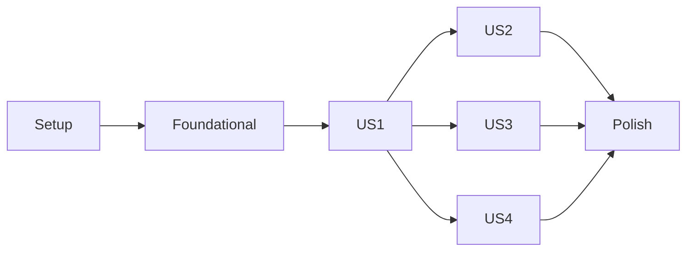

# Tasks: Fundação do Monorepo (web, api, mobile + contratos compartilhados)

**Input**: Design documents from `/specs/001-monorepo-setup/`
**Prerequisites**: plan.md, spec.md, research.md, data-model.md, contracts/, quickstart.md

**Tests**: INCLUÍDOS — a Constituição (Princípio IV) exige Test-First. Testes de cada story
devem ser escritos primeiro e FALHAR antes da implementação.

**Organization**: tarefas agrupadas por user story para entrega e teste independentes.

## Format: `[ID] [P?] [Story] Description`
- **[P]**: pode rodar em paralelo (arquivos diferentes, sem dependência pendente)
- **[Story]**: US1–US4 conforme spec.md

---

## Phase 1: Setup (raiz do monorepo)

**Purpose**: inicializar workspace pnpm + Turborepo com versões travadas (research R1, R2)

- [x] T001 Criar `package.json` raiz (`private: true`, `name: "fono"`, `"packageManager": "pnpm@9.12.0"`, `engines: { node: ">=22 <23", pnpm: ">=9 <10" }`, script `preinstall: "npx only-allow pnpm"`) em package.json
- [x] T002 [P] Criar `pnpm-workspace.yaml` com `packages: ["apps/*", "packages/*"]` em pnpm-workspace.yaml
- [x] T003 [P] Criar `.npmrc` com `engine-strict=true` e `auto-install-peers=true` em .npmrc
- [x] T004 [P] Criar `.nvmrc` com `22` em .nvmrc
- [x] T005 [P] Criar `.gitignore` (node_modules, dist, .turbo, coverage, .expo, .env, .env.*, exceto .env.example) em .gitignore
- [x] T006 [P] Criar `.editorconfig` e `.prettierrc` (printWidth 100, singleQuote) em .editorconfig e .prettierrc
- [x] T007 Instalar `turbo` e `prettier` como devDependencies raiz e criar `turbo.json` com tasks `build` (dependsOn `^build`, outputs `dist/**`), `typecheck` (dependsOn `^build`), `lint`, `test` (dependsOn `^build`, outputs `coverage/**`), `db:validate` (cache false), `dev` (dependsOn `^build`, cache false, persistent true) conforme contracts/workspace-tasks.md em turbo.json
- [x] T008 Adicionar scripts raiz `dev`, `lint`, `typecheck`, `build`, `test`, `format` e `ci` (`turbo run lint typecheck build test db:validate`) em package.json

---

## Phase 2: Foundational (bloqueia todas as stories)

**Purpose**: configs compartilhadas e esqueleto do pacote de contratos

**⚠️ CRITICAL**: nenhuma user story começa antes desta fase

- [x] T009 [P] Criar pacote `@fono/tsconfig` com `package.json` e `base.json` (`strict`, `noUncheckedIndexedAccess`, `noImplicitOverride`, `exactOptionalPropertyTypes`, `target ES2022`, `moduleResolution bundler`) em packages/tsconfig/base.json
- [x] T010 [P] Criar presets `react.json` (lib DOM, jsx react-jsx), `nest.json` (module commonjs, emitDecoratorMetadata, experimentalDecorators) e `expo.json` (extends `expo/tsconfig.base` + strict) em packages/tsconfig/
- [x] T011 [P] Criar pacote `@fono/eslint-config` (flat config, typescript-eslint) com preset `base.js` contendo `@typescript-eslint/no-explicit-any: "error"` em packages/eslint-config/base.js
- [x] T012 Criar presets `react.js`, `nest.js` e `react-native.js` estendendo `base.js` em packages/eslint-config/
- [x] T013 Criar esqueleto `@fono/shared` (`package.json` com `exports` ESM/CJS/types conforme contracts/shared-package.md, dependência única `zod@^3`, devDeps `tsup`, `vitest`, `@fono/tsconfig`, `@fono/eslint-config`, `eslint.config.js` estendendo `@fono/eslint-config/base.js`) em packages/shared/package.json
- [x] T014 Configurar `tsup.config.ts` (entry `src/index.ts`, formats `esm`+`cjs`, `dts: true`, `clean: true`) e `tsconfig.json` (extends base, `lib: ["ES2022"]` sem DOM) em packages/shared/
- [x] T015 Criar `src/index.ts` vazio exportável e scripts `dev`, `build`, `lint`, `typecheck`, `test` em packages/shared/src/index.ts
- [x] T016 Executar `pnpm install` na raiz e confirmar geração de `pnpm-lock.yaml`

**Checkpoint**: `pnpm build --filter @fono/shared` passa

---

## Phase 3: User Story 1 - Preparar o ambiente com um único comando (Priority: P1) 🎯 MVP

**Goal**: clone → `pnpm install` → `pnpm dev` sobe web, api e mobile

**Independent Test**: quickstart cenários 1–4

### Implementation for User Story 1

- [x] T017 [P] [US1] Criar app `@fono/web` com Vite + React + TS (`package.json`, `vite.config.ts`, `index.html`, `src/main.tsx`, `src/app/App.tsx`), `tsconfig.json` estendendo `@fono/tsconfig/react.json` e `eslint.config.js` estendendo `@fono/eslint-config/react.js` em apps/web/
- [x] T018 [P] [US1] Criar app `@fono/api` com NestJS (`package.json`, `nest-cli.json`, `src/main.ts`, `src/app.module.ts`), `tsconfig.json` estendendo `@fono/tsconfig/nest.json` e `eslint.config.js` estendendo `@fono/eslint-config/nest.js`, porta 3000 em apps/api/
- [x] T019 [P] [US1] Criar app `@fono/mobile` com Expo + Expo Router (`package.json`, `app.json`, `src/app/_layout.tsx`, `src/app/index.tsx`), `tsconfig.json` estendendo `@fono/tsconfig/expo.json` e `eslint.config.js` estendendo `@fono/eslint-config/react-native.js` em apps/mobile/
- [x] T020 [US1] Configurar `metro.config.js` para monorepo (`watchFolders` na raiz, `nodeModulesPaths` app + raiz) em apps/mobile/metro.config.js
- [x] T021 [P] [US1] Configurar Tailwind CSS + shadcn/ui (fonte Inter, paleta Azul/Teal, dark mode) e criar estrutura `src/features/`, `src/components/ui/`, `src/lib/` em apps/web/
- [x] T022 [P] [US1] Adicionar `helmet`, CORS por allowlist (`CORS_ORIGINS`), `@nestjs/throttler` (100 req/min global) e logger estruturado com sanitização de campos sensíveis (passwords, tokens, secrets) conforme Princípio VI em apps/api/src/common/logger/ e apps/api/src/main.ts
- [x] T023 [US1] Padronizar scripts `dev`, `lint`, `typecheck`, `build`, `test` nos três apps conforme contracts/workspace-tasks.md em apps/*/package.json
- [x] T024 [US1] Validar `pnpm dev` (todos) e `pnpm dev --filter @fono/web` (só shared + web) — quickstart cenários 3–4
- [x] T025 [US1] Validar que `npm install` falha exigindo pnpm — quickstart cenário 2

**Checkpoint**: US1 funcional e demonstrável

---

## Phase 4: User Story 2 - Contratos compartilhados como fonte única de verdade (Priority: P1)

**Goal**: `HealthResponse` definido uma vez em shared e consumido por web, api e mobile

**Independent Test**: quickstart cenários 5–7

### Tests for User Story 2 (escrever primeiro, devem falhar) ⚠️

- [x] T026 [P] [US2] Teste unitário do `HealthResponseSchema` (aceita payload válido; rejeita `status` fora de `"ok" | "degraded"`, `service` vazio ou > 50 chars após trim, `version` não-semver, `timestamp` não ISO 8601) em packages/shared/src/health/health.schema.test.ts
- [x] T027 [P] [US2] Teste unitário de `parseEnv` (erro lista apenas nomes das chaves inválidas, nunca valores) em packages/shared/src/env/parse-env.test.ts
- [x] T028 [P] [US2] Teste e2e Supertest `GET /health` → 200 com corpo válido por `HealthResponseSchema` em apps/api/test/health.e2e-spec.ts
- [x] T029 [P] [US2] Teste do hook `useHealth` (estados loading, error e sucesso com resposta validada) em apps/web/src/features/health/hooks/use-health.test.tsx
- [x] T030 [P] [US2] Teste do hook `useHealth` com jest-expo em apps/mobile/src/features/health/hooks/use-health.test.tsx

### Implementation for User Story 2

- [x] T031 [US2] Implementar `HealthResponseSchema` (`status: z.enum(["ok","degraded"])`, `service: z.string().trim().min(1).max(50)`, `version` semver via regex, `timestamp: z.string().datetime()`) e tipo `HealthResponse = z.infer<...>` em packages/shared/src/health/health.schema.ts
- [x] T032 [US2] Implementar `parseEnv(schema, source)` em packages/shared/src/env/parse-env.ts
- [x] T033 [US2] Reexportar `HealthResponseSchema`, `HealthResponse` e `parseEnv` em packages/shared/src/index.ts
- [x] T034 [US2] Adicionar regra `no-restricted-imports` bloqueando `node:*`, `react`, `react-native`, `@nestjs/*`, `@prisma/*` no lint do shared em packages/shared/eslint.config.js
- [x] T035 [P] [US2] Validar env da api com Zod (`PORT`, `DATABASE_URL`, `CORS_ORIGINS`) via `parseEnv` em apps/api/src/config/env.ts
- [x] T036 [US2] Implementar `HealthModule` (controller + service) retornando `HealthResponse` validado com `nestjs-zod` em apps/api/src/health/
- [x] T037 [P] [US2] Criar instância Axios (`VITE_API_URL` validado por Zod) em apps/web/src/lib/api-client.ts e `QueryClientProvider` em apps/web/src/app/providers.tsx
- [x] T038 [US2] Implementar hook `useHealth` (TanStack Query + `HealthResponseSchema.parse`) em apps/web/src/features/health/hooks/use-health.ts
- [x] T039 [US2] Implementar `HealthStatusCard` com estados Skeleton / EmptyState / Error (toast) e ErrorBoundary em apps/web/src/features/health/components/health-status-card.tsx
- [x] T040 [P] [US2] Criar instância Axios (`EXPO_PUBLIC_API_URL` validado) e `QueryClientProvider` em apps/mobile/src/lib/api-client.ts e apps/mobile/src/app/_layout.tsx
- [x] T041 [US2] Implementar hook `useHealth` e tela de status com estados loading/empty/error em apps/mobile/src/features/health/
- [x] T042 [US2] Adicionar regra de lint bloqueando import entre apps (`@fono/web|api|mobile` e caminhos `apps/*`) no preset base em packages/eslint-config/base.js
- [x] T043 [P] [US2] Criar `.env.example` de cada app (sem valores reais) em apps/web/.env.example, apps/api/.env.example, apps/mobile/.env.example
- [x] T044 [US2] Validar quickstart cenários 5 (health ponta a ponta), 6 (contrato quebrado falha em 3 apps), 7 (import entre apps falha) e 9 (env inválido)

**Checkpoint**: US1 + US2 funcionais — MVP completo

---

## Phase 5: User Story 3 - Pipeline de qualidade independente por workspace (Priority: P2)

**Goal**: CI com job por app, execução seletiva, cache e bloqueio de merge

**Independent Test**: quickstart cenários 10–12

### Tests for User Story 3 ⚠️

- [x] T045 [P] [US3] Teste do script de checagem de migrations destrutivas (falha com `DROP TABLE`, `DROP COLUMN`, `TRUNCATE`; passa com `CREATE TABLE`) em apps/api/scripts/check-destructive-migrations.test.ts

### Implementation for User Story 3

- [x] T046 [P] [US3] Inicializar Prisma (`schema.prisma` com datasource PostgreSQL, sem modelos de negócio) em apps/api/prisma/schema.prisma
- [x] T047 [US3] Implementar script de checagem de migrations destrutivas (respeita env `ALLOW_DESTRUCTIVE_MIGRATION=true`) em apps/api/scripts/check-destructive-migrations.ts
- [x] T048 [US3] Adicionar script `db:validate` (`prisma validate && tsx scripts/check-destructive-migrations.ts`) em apps/api/package.json
- [x] T049 [US3] Criar workflow com job `changes` (checkout fetch-depth 0, `turbo run build --filter=...[origin/main] --dry=json`, outputs por workspace) em .github/workflows/ci.yml
- [x] T050 [US3] Adicionar jobs `shared`, `web`, `api` (com service Postgres e `prisma migrate deploy` em banco efêmero) e `mobile`, condicionados ao job `changes`, rodando `turbo run lint typecheck build test [db:validate] --filter=<app>...` em .github/workflows/ci.yml
- [x] T051 [US3] Configurar cache pnpm (`actions/setup-node` com `cache: pnpm`) e `.turbo` (`actions/cache`), além de `workflow_dispatch` com `TURBO_FORCE` em .github/workflows/ci.yml
- [x] T052 [US3] Adicionar job `security` com gitleaks (`fetch-depth: 0`), job agregador `ci-status` e documentação de branch protection para `main` em .github/workflows/ci.yml e .github/branch-protection.md
- [x] T053 [US3] Mapear label `allow-destructive-migration` para `ALLOW_DESTRUCTIVE_MIGRATION=true` no job `api` em .github/workflows/ci.yml
- [x] T054 [US3] Validar quickstart cenários 10 (cache `FULL TURBO`), 11 (PR só web) e 12 (migration destrutiva falha)

**Checkpoint**: CI funcional por app

---

## Phase 6: User Story 4 - Configurações e padrões compartilhados (Priority: P3)

**Goal**: mesmas regras de TS/ESLint/Prettier herdadas por todos os workspaces

**Independent Test**: quickstart cenário 8

- [x] T055 [P] [US4] Auditar e verificar conformidade de `eslint.config.js` em todos os workspaces (web, api, mobile, shared) garantindo herança de `@fono/eslint-config` e proibição estrita de `any`
- [x] T056 [P] [US4] Auditar e verificar `tsconfig.json` de cada workspace estendendo `@fono/tsconfig` sem afrouxar `strict` em apps/*/tsconfig.json
- [x] T057 [US4] Validar cenário 8: `const x: any` falha com `@typescript-eslint/no-explicit-any` em todos os workspaces

**Checkpoint**: todas as stories independentes e funcionais

---

## Phase 7: Polish & Cross-Cutting Concerns

- [x] T058 [P] Documentar pré-requisitos, instalação, comandos (`dev`, `lint`, `typecheck`, `build`, `test`, `ci`) e estrutura do monorepo em README.md
- [x] T059 [P] Adicionar `CODEOWNERS` e template de PR com checklist da Constituição em .github/
- [x] T060 Executar `pnpm ci` completo e todos os cenários de specs/001-monorepo-setup/quickstart.md
- [x] T061 Emendar Constituição para v2.1.0 incluindo `apps/mobile` (Expo) e guardrails ratificada via `/speckit-constitution` em .specify/memory/constitution.md

---

## Dependencies & Execution Order

### Phase Dependencies
- **Setup (1)** → **Foundational (2)** → bloqueia todas as stories
- **US1 (3)**: depende de Foundational
- **US2 (4)**: depende de US1 (precisa dos apps existentes)
- **US3 (5)**: depende de US1 (scripts dos apps); integra melhor após US2
- **US4 (6)**: depende de Foundational + apps de US1; independente de US2/US3
- **Polish (7)**: após as stories desejadas



### Within Each Story
- Testes primeiro (devem falhar) → shared → api → web/mobile → validação

## Parallel Opportunities

```bash
# Phase 1
T002, T003, T004, T005, T006
# Phase 2
T009, T010, T011  (depois T012; T013→T014→T015)
# US1: os três apps em paralelo
T017 (web), T018 (api), T019 (mobile); depois T021, T022
# US2: todos os testes juntos
T026, T027, T028, T029, T030
# US2: clientes web e mobile em paralelo após T033
T037 + T038 + T039  ||  T040 + T041
# Após US1: US3 e US4 podem andar em paralelo
```

## Implementation Strategy

### MVP First
1. Phases 1–2
2. Phase 3 (US1) → validar cenários 1–4
3. Phase 4 (US2) → validar cenários 5–7, 9 → **MVP: monorepo funcional com contratos compartilhados**

### Incremental Delivery
4. US3 → CI protegendo `main`
5. US4 → padronização garantida
6. Polish → README, PR template, emenda da Constituição
