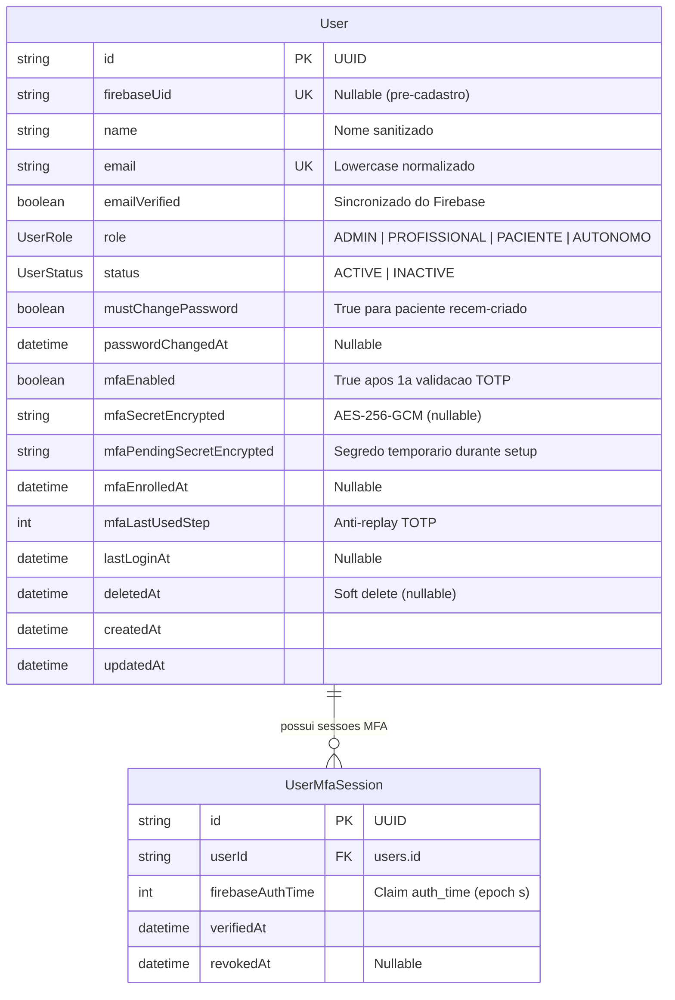
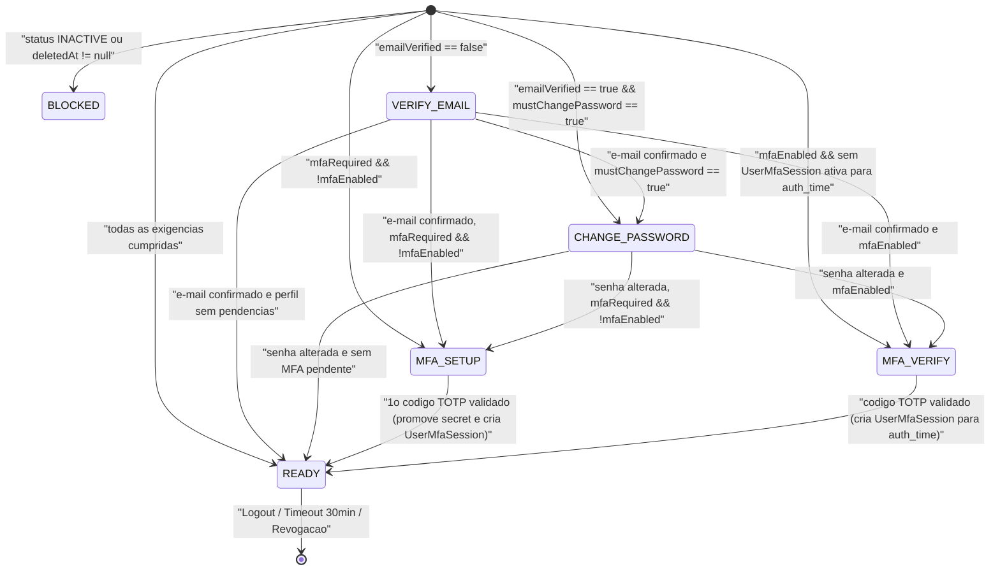

# Modelo de Dados: Autenticação, Perfis e Sessões MFA

**Feature**: `002-firebase-auth-login`  
**Data**: 2026-11-21  
**Spec**: [spec.md](./spec.md) | **Pesquisa**: [research.md](./research.md)

Este documento define o modelo relacional em PostgreSQL (Prisma ORM) que atua como **única fonte de verdade** para usuários, perfis de autorização (`role`), estado de primeiro acesso e verificação MFA TOTP da FonoGames.

---

## 1. Visão Geral e Relacionamentos

---

## 2. Enums

### `UserRole`
Define o perfil de acesso exclusivo na fonte de verdade interna (`FR-003`, `FR-004`).

| Valor | Descrição | Auto-cadastro | MFA Obrigatório (`mfaRequired`) | Rota Inicial Web |
| :--- | :--- | :--- | :--- | :--- |
| `ADMIN` | Gestor do sistema | Não | **Sim** (`FR-005`) | `/admin` |
| `PROFISSIONAL` | Fonoaudiólogo | Não | **Sim** (`FR-005`) | `/profissional` |
| `PACIENTE` | Paciente / Responsável | Não (criado pelo fonoaudiólogo) | Opcional | `/paciente` |
| `AUTONOMO` | Pessoa comum | **Sim** (`FR-006`) | Opcional | `/dashboard` |

### `UserStatus`
Define o estado operacional da conta (`FR-001`, Edge Case de conta inativa/revogada).

| Valor | Descrição | Efeito na Autenticação |
| :--- | :--- | :--- |
| `ACTIVE` | Conta habilitada para operar no sistema | Login permitido conforme máquina de estados `AuthNextStep` |
| `INACTIVE` | Conta suspensa ou desativada | Bloqueada imediatamente em todas as rotas (`403 ACCOUNT_INACTIVE`) |

---

## 3. Entidades

### 3.1 `User` (`@@map("users")`)

Representa a **Conta de Usuário** interna da FonoGames.

| Campo | Tipo Prisma | Mapeamento SQL | Restrições / Default | Descrição e Regras |
| :--- | :--- | :--- | :--- | :--- |
| `id` | `String` | `id` | `@id @default(uuid())` | Identificador único interno (nunca aceito do body cliente — Princípio III). |
| `firebaseUid` | `String?` | `firebase_uid` | `@unique`, nullable | UID emitido pelo Firebase Authentication. Permanece `null` em pré-cadastros (`PROFISSIONAL`/`PACIENTE`) até o primeiro login com e-mail verificado (`R-03`). |
| `name` | `String` | `name` | Obrigatório | Nome de exibição sanitizado (`.trim()`, sem tags HTML, 2–120 caracteres). |
| `email` | `String` | `email` | `@unique` | E-mail normalizado em minúsculas (`trim().toLowerCase()`). |
| `emailVerified` | `Boolean` | `email_verified` | `@default(false)` | Espelho do estado `email_verified` verificado no ID Token do Firebase (`FR-006`). |
| `role` | `UserRole` | `role` | `@default(AUTONOMO)` | Perfil de acesso atribuído pelo sistema; nunca alterável via `/auth/sync` (`FR-004`). |
| `status` | `UserStatus` | `status` | `@default(ACTIVE)` | Estado de ativação da conta. |
| `mustChangePassword` | `Boolean` | `must_change_password` | `@default(false)` | Marcado como `true` quando um `PACIENTE` é pré-cadastrado com senha temporária gerada pelo fonoaudiólogo (`FR-007`). |
| `passwordChangedAt` | `DateTime?` | `password_changed_at` | Nullable | Carimbo da última troca obrigatória/registrada de senha. |
| `mfaEnabled` | `Boolean` | `mfa_enabled` | `@default(false)` | Indica se o usuário concluiu a ativação de TOTP via app autenticador (`FR-005`). |
| `mfaSecretEncrypted` | `String?` | `mfa_secret_encrypted` | Nullable | Segredo TOTP ativo cifrado com AES-256-GCM (`iv:authTag:ciphertext`). **Nunca** retornado em API nem registrado em log (`FR-014`). |
| `mfaPendingSecretEncrypted` | `String?` | `mfa_pending_secret_encrypted` | Nullable | Segredo temporário gerado durante `/auth/mfa/setup` antes da 1ª validação TOTP bem-sucedida. Evita invalidar um MFA ativo caso o setup seja abandonado. |
| `mfaEnrolledAt` | `DateTime?` | `mfa_enrolled_at` | Nullable | Data/hora de conclusão do vínculo TOTP. |
| `mfaLastUsedStep` | `Int?` | `mfa_last_used_step` | Nullable | Índice do último intervalo de 30s (`Math.floor(Date.now() / 30000)`) validado com sucesso (anti-replay). |
| `lastLoginAt` | `DateTime?` | `last_login_at` | Nullable | Data/hora do último login sincronizado. |
| `deletedAt` | `DateTime?` | `deleted_at` | Nullable | Preenchido em exclusão lógica (Soft Delete, Princípio VI). Contas com `deletedAt != null` são tratadas como bloqueadas (`ACCOUNT_INACTIVE`). |
| `createdAt` | `DateTime` | `created_at` | `@default(now())` | Carimbo de criação. |
| `updatedAt` | `DateTime` | `updated_at` | `@updatedAt` | Carimbo de atualização automática. |

**Índices de `User`:**
- `@@unique([firebaseUid])`
- `@@unique([email])`
- `@@index([role, status])`
- `@@index([deletedAt])`

---

### 3.2 `UserMfaSession` (`@@map("user_mfa_sessions")`)

Representa a comprovação de desafio TOTP para uma autenticação específica do Firebase Authentication (**Sessão Autenticada** com segundo fator verificado).

| Campo | Tipo Prisma | Mapeamento SQL | Restrições / Default | Descrição e Regras |
| :--- | :--- | :--- | :--- | :--- |
| `id` | `String` | `id` | `@id @default(uuid())` | Identificador único da sessão MFA. |
| `userId` | `String` | `user_id` | FK → `users.id` (`onDelete: Cascade`) | Usuário dono da sessão. Como `User` nunca sofre exclusão física (apenas soft delete), `Cascade` protege apenas limpeza de testes/manutenção sem quebrar histórico clínico. |
| `firebaseAuthTime` | `Int` | `firebase_auth_time` | Obrigatório | Valor inteiro (epoch em segundos) da claim `auth_time` do Firebase ID Token que originou o login com senha. |
| `verifiedAt` | `DateTime` | `verified_at` | `@default(now())` | Momento em que o código TOTP foi validado com sucesso. |
| `revokedAt` | `DateTime?` | `revoked_at` | Nullable | Preenchido no logout explícito (`POST /auth/logout`), no reset administrativo de MFA ou na desativação da conta (`FR-009`, `FR-010`). |

**Restrições e Índices de `UserMfaSession`:**
- `@@unique([userId, firebaseAuthTime])` — uma sessão MFA ativa ou revogada por evento de login (`auth_time`).
- `@@index([userId, revokedAt])` — consulta rápida para verificar se o token atual possui segundo fator validado.

---

## 4. Propriedades Derivadas e Regras de Validação

1. **Derivação de `mfaRequired` (não persistida no banco, calculada na camada de domínio):**
   - `mfaRequired = (user.role === UserRole.ADMIN || user.role === UserRole.PROFISSIONAL)`
2. **Política de Senha (`FR-002`, `FR-006`, `FR-007`):**
   - Mínimo de **8 caracteres** (`length >= 8`), máximo de 128 caracteres.
   - Obrigatório conter ao menos **1 letra maiúscula** (`/[A-Z]/`) e **1 letra minúscula** (`/[a-z]/`).
3. **Validação Anti-Replay TOTP (`FR-005`):**
   - Janela aceita: passo atual `T` e adjacentes `[T - 1, T, T + 1]` (período de 30s, 6 dígitos).
   - O passo validado (`matchedStep`) deve satisfazer `user.mfaLastUsedStep == null || matchedStep > user.mfaLastUsedStep`; após sucesso, atualiza `mfaLastUsedStep = matchedStep` atomicamente no banco.
4. **Higienização e Soft Delete (`Princípio VI`):**
   - Ao desativar um usuário (`status = INACTIVE` e `deletedAt = now()`), o serviço deve revogar todas as `UserMfaSession` onde `revokedAt IS NULL` e chamar `firebaseAdmin.revokeRefreshTokens(firebaseUid)`.
   - A migration inicial desta feature será puramente aditiva (`CREATE TYPE`, `CREATE TABLE`, `CREATE INDEX`), cumprindo a política de zero comandos destrutivos (`DROP`/`TRUNCATE`) validada pelo script `check-destructive-migrations` no CI.

---

## 5. Máquina de Estados da Sessão (`AuthNextStep`)

