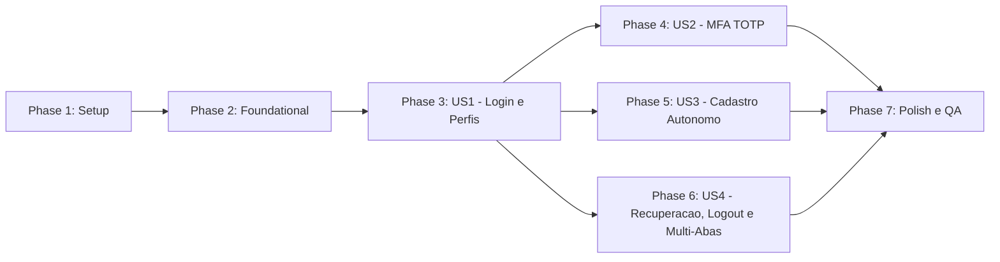

# Tasks: Autenticação e Login do Sistema com Firebase Auth

**Input**: Design documents from `/specs/002-firebase-auth-login/`
**Prerequisites**: [plan.md](./plan.md) (required), [spec.md](./spec.md) (required), [research.md](./research.md), [data-model.md](./data-model.md), [contracts/](./contracts/), [quickstart.md](./quickstart.md)

**Tests**: INCLUÍDOS — a Constituição v2.3.0 (Princípio IV) exige desenvolvimento Test-First. Os testes de contrato, unidade, integração HTTP (Supertest) e interface devem ser escritos primeiro e **FALHAR** antes da implementação correspondente.

**Organization**: Tarefas agrupadas por fase e por User Story (em ordem de prioridade P1 → P2) para permitir implementação e validação independentes de cada incremento.

## Format: `[ID] [P?] [Story] Description`

- **[P]**: Pode ser executada em paralelo (arquivos distintos, sem dependência de tarefa incompleta)
- **[Story]**: User Story correspondente (`US1`, `US2`, `US3`, `US4`) — presente apenas nas fases de história de usuário
- Todas as tarefas incluem caminhos exatos de arquivo no repositório

## Path Conventions

- **Contratos compartilhados (`@fono/shared`)**: `packages/shared/src/`
- **Backend API (`@fono/api`)**: `apps/api/src/`, `apps/api/prisma/`, `apps/api/test/`
- **Frontend Web (`@fono/web`)**: `apps/web/src/`

---

## Phase 1: Setup (Dependências e Variáveis de Ambiente)

**Purpose**: Instalar dependências do Firebase SDK, Firebase Admin e TOTP/QR Code nos workspaces e documentar variáveis de ambiente sem versionar segredos.

- [X] T001 Adicionar dependências `firebase-admin` e `otpauth` para verificação de ID Tokens e geração/validação TOTP em `apps/api/package.json`
- [X] T002 [P] Adicionar dependências `firebase` e `qrcode.react` para SDK Auth modular e renderização SVG de QR Code em `apps/web/package.json`
- [X] T003 [P] Documentar variáveis `FIREBASE_PROJECT_ID`, `FIREBASE_CLIENT_EMAIL`, `FIREBASE_PRIVATE_KEY`, `FIREBASE_AUTH_EMULATOR_HOST` e `MFA_ENCRYPTION_KEY` (sem segredos reais) em `apps/api/.env.example`
- [X] T004 [P] Criar arquivo de exemplo com `VITE_API_URL`, `VITE_FIREBASE_API_KEY`, `VITE_FIREBASE_AUTH_DOMAIN`, `VITE_FIREBASE_PROJECT_ID`, `VITE_FIREBASE_APP_ID` e `VITE_FIREBASE_AUTH_EMULATOR_URL` (sem segredos reais) em `apps/web/.env.example`
- [X] T005 Executar `pnpm install` na raiz do monorepo para resolver dependências e validar atualização de `pnpm-lock.yaml`

---

## Phase 2: Foundational (Infraestrutura Bloqueante para Todas as Stories)

**Purpose**: Contratos Zod compartilhados, modelagem Prisma (`User`, `UserMfaSession`), validação de env vars, redação de logs, guards de segurança da API e camada base de serviços/UI Web.

**⚠️ CRITICAL**: Nenhuma User Story pode iniciar antes da conclusão desta fase.

- [X] T006 [P] Escrever testes unitários Test-First validando `PasswordSchema` (mínimo 8 caracteres, máximo 128, ao menos 1 letra maiúscula `/[A-Z]/` e 1 minúscula `/[a-z]/`, sem `.trim()`), `SanitizedNameSchema` (`.trim()`, remoção de tags HTML, 2–120 caracteres), `NormalizedEmailSchema` (`.trim().toLowerCase()`, máximo 254 caracteres), `SyncAuthRequestSchema` (`.strict()` rejeitando `role` e `status`), `TotpCodeSchema` (`/^\d{6}$/`), `RegisterAutonomousSchema` (confirmação de senha) e `ChangePasswordSchema` (nova senha diferente da temporária) em `packages/shared/src/auth/auth.schema.test.ts`
- [X] T007 [P] Criar enums `UserRoleSchema` (`'ADMIN' | 'PROFISSIONAL' | 'PACIENTE' | 'AUTONOMO'`), `UserStatusSchema` (`'ACTIVE' | 'INACTIVE'`), `AuthNextStepSchema` (`'VERIFY_EMAIL' | 'CHANGE_PASSWORD' | 'MFA_SETUP' | 'MFA_VERIFY' | 'READY'`), `AuthErrorCodeSchema` e constantes (`PASSWORD_MIN_LENGTH = 8`, `PASSWORD_MAX_LENGTH = 128`, `TOTP_CODE_LENGTH = 6`, `SESSION_INACTIVITY_TIMEOUT_MS = 1800000`, `ROLE_HOME_ROUTES`) em `packages/shared/src/auth/auth.enums.ts`
- [X] T008 Implementar schemas Zod (`NormalizedEmailSchema`, `SanitizedNameSchema`, `PasswordSchema`, `LoginPasswordSchema`, `TotpCodeSchema`, `LoginSchema`, `RegisterAutonomousSchema`, `ForgotPasswordSchema`, `ChangePasswordSchema`, `SyncAuthRequestSchema`, `MfaSetupResponseSchema`, `AuthUserProfileSchema`, `AuthSessionResponseSchema`, `AdminResetMfaResponseSchema`, `ApiErrorResponseSchema`) com tipos `z.infer<>` em `packages/shared/src/auth/auth.schema.ts`, reexportar em `packages/shared/src/auth/index.ts` e `packages/shared/src/index.ts`, e validar `pnpm --filter @fono/shared build && pnpm --filter @fono/shared test`
- [X] T009 Modelar enums `UserRole` (`ADMIN`, `PROFISSIONAL`, `PACIENTE`, `AUTONOMO`), `UserStatus` (`ACTIVE`, `INACTIVE`) e modelos `User` (`@@map("users")`, `id` UUID, `firebaseUid` String? `@unique`, `name` String, `email` String `@unique`, `emailVerified` Boolean `@default(false)`, `role` UserRole `@default(AUTONOMO)`, `status` UserStatus `@default(ACTIVE)`, `mustChangePassword` Boolean `@default(false)`, `passwordChangedAt` DateTime?, `mfaEnabled` Boolean `@default(false)`, `mfaSecretEncrypted` String?, `mfaPendingSecretEncrypted` String?, `mfaEnrolledAt` DateTime?, `mfaLastUsedStep` Int?, `lastLoginAt` DateTime?, `deletedAt` DateTime?, `createdAt`, `updatedAt`, índices `@@index([role, status])` e `@@index([deletedAt])`) e `UserMfaSession` (`@@map("user_mfa_sessions")`, `id` UUID, `userId` FK para `users.id` com `onDelete: Cascade`, `firebaseAuthTime` Int, `verifiedAt`, `revokedAt` DateTime?, `@@unique([userId, firebaseAuthTime])`, `@@index([userId, revokedAt])`) em `apps/api/prisma/schema.prisma`
- [X] T010 Criar migration Prisma puramente aditiva (sem `DROP TABLE`, `DROP COLUMN` ou `TRUNCATE`) em `apps/api/prisma/migrations/` e validar com `pnpm --filter @fono/api db:generate && pnpm --filter @fono/api db:validate`
- [X] T011 [P] Atualizar `ApiEnvSchema` validando `FIREBASE_PROJECT_ID`, `FIREBASE_CLIENT_EMAIL`, `FIREBASE_PRIVATE_KEY` (normalização `\n`), `FIREBASE_AUTH_EMULATOR_HOST` opcional e `MFA_ENCRYPTION_KEY` (32 bytes em hex ou base64) em `apps/api/src/config/env.ts` e adicionar casos de teste em `apps/api/src/config/env.spec.ts`
- [X] T012 [P] Atualizar `WebEnvSchema` validando `VITE_FIREBASE_API_KEY`, `VITE_FIREBASE_AUTH_DOMAIN`, `VITE_FIREBASE_PROJECT_ID`, `VITE_FIREBASE_APP_ID` e `VITE_FIREBASE_AUTH_EMULATOR_URL` opcional em `apps/web/src/lib/env.ts` e adicionar casos de teste em `apps/web/src/lib/env.test.ts`
- [X] T013 [P] Expandir `SENSITIVE_KEYS` para redigir `newpassword`, `currentpassword`, `confirmpassword`, `mfasecret`, `mfasecretencrypted`, `mfapendingsecretencrypted`, `otpauthuri`, `manualentrykey`, `totp`, `totpcode`, `code`, `firebase_private_key` e `mfa_encryption_key` em `apps/api/src/common/logger/structured-logger.service.ts` e cobrir com testes unitários em `apps/api/src/common/logger/structured-logger.service.spec.ts`
- [X] T014 [P] Implementar `FirebaseAdminService` encapsulando inicialização da Service Account, suporte a `FIREBASE_AUTH_EMULATOR_HOST`, `verifyIdToken(token, true)` (`checkRevoked: true` obrigatório), `getUser(uid)` (para leitura de `tokensValidAfterTime`) e `revokeRefreshTokens(uid)` em `apps/api/src/auth/firebase-admin.service.ts`
- [X] T015 [P] Criar tipo estrito `CurrentAuthUser` e decorators `@CurrentUser()`, `@Roles(...)`, `@AllowPendingSession()` e `@AllowUnlinkedSync()` em `apps/api/src/auth/decorators/current-user.decorator.ts`, `apps/api/src/auth/decorators/roles.decorator.ts`, `apps/api/src/auth/decorators/allow-pending-session.decorator.ts` e `apps/api/src/auth/decorators/allow-unlinked-sync.decorator.ts`
- [X] T016 Implementar guards `FirebaseAuthGuard` (`401 INVALID_TOKEN`/`TOKEN_REVOKED`, `403 ACCOUNT_INACTIVE` quando `status === 'INACTIVE'` ou `deletedAt != null`, e modo opcional `@AllowUnlinkedSync()` para `/auth/sync`), `SessionReadyGuard` (exige `nextStep === 'READY'` fora de `@AllowPendingSession()`, retornando `403 EMAIL_NOT_VERIFIED`, `PASSWORD_CHANGE_REQUIRED`, `MFA_SETUP_REQUIRED` ou `MFA_VERIFICATION_REQUIRED`) e `RolesGuard` (`403 FORBIDDEN_ROLE` a partir do `role` do PostgreSQL) em `apps/api/src/auth/guards/firebase-auth.guard.ts`, `apps/api/src/auth/guards/session-ready.guard.ts` e `apps/api/src/auth/guards/roles.guard.ts`
- [X] T017 [P] Criar primitivos shadcn/ui acessíveis com tokens semânticos de `apps/web/src/index.css` (zero cores hex, foco visível `focus-visible:ring-2 focus-visible:ring-ring` e atributos `aria-*` WCAG AA) em `apps/web/src/components/ui/input.tsx`, `apps/web/src/components/ui/label.tsx` e `apps/web/src/components/ui/alert.tsx`
- [X] T018 [P] Implementar serviço Firebase Web (`browserLocalPersistence`, conexão opcional ao Auth Emulator, ações de login, auto-cadastro, redefinição de senha, reenvio/reload de verificação de e-mail, reautenticação + `updatePassword` e tradução segura de erros Firebase para PT-BR) em `apps/web/src/features/auth/services/firebase-auth.service.ts`
- [X] T019 [P] Configurar interceptors Axios (anexando `Authorization: Bearer` via `auth.currentUser?.getIdToken()` em memória, executando 1 único retry silencioso com `getIdToken(true)` em `401 INVALID_TOKEN` antes de acionar logout, e disparando logout imediato em `401 TOKEN_REVOKED` ou `403 ACCOUNT_INACTIVE`) em `apps/web/src/lib/api-client.ts` e implementar chamadas tipadas validadas com Zod (`syncAuth`, `getMe`, `confirmPasswordChanged`, `setupMfa`, `verifyMfa`, `logoutServer`) em `apps/web/src/features/auth/services/auth-api.service.ts`
- [X] T020 [P] Criar `AuthLayout` (card `rounded-3xl bg-card`, logo `bg-brand-amber`, zero anúncios) em `apps/web/src/features/auth/components/auth-layout.tsx` e `PasswordRequirementsHint` (feedback objetivo dos critérios de `FR-002`: 8+ chars, maiúscula e minúscula) em `apps/web/src/features/auth/components/password-requirements-hint.tsx`

**Checkpoint**: Fundação completa (`@fono/shared` compilado, schema Prisma validado, guards API e camada base Web prontos) — implementação das User Stories pode iniciar.

---

## Phase 3: User Story 1 - Login de Usuário com Credenciais Válidas (Priority: P1) 🎯 MVP

**Goal**: Permitir login por e-mail e senha via Firebase Auth, sincronização idempotente com PostgreSQL (`POST /auth/sync`), retenção obrigatória para verificação de e-mail (`VERIFY_EMAIL`) e troca de senha no primeiro acesso do `PACIENTE` (`CHANGE_PASSWORD`), e redirecionamento isolado ao painel inicial dedicado por perfil (`/admin`, `/profissional`, `/paciente`, `/dashboard`).

**Independent Test**: Inserir credenciais válidas na tela `/login` (com token/emulador ou mocks E2E) e confirmar que `POST /auth/sync` e `GET /auth/me` retornam o `role` do PostgreSQL e `nextStep`, bloqueando acesso a rotas de outros perfis, retendo `PACIENTE` com `mustChangePassword = true` em `/primeiro-acesso/nova-senha` e exibindo mensagem genérica para credenciais inválidas.

### Tests for User Story 1 (escrever primeiro, devem FALHAR) ⚠️

- [X] T021 [P] [US1] Escrever testes unitários Test-First para `AuthService` (`syncUser`, `getSession`, `confirmPasswordChanged` validando `tokensValidAfterTime` posterior à troca via `firebaseAdmin.getUser` e rejeitando `403 PASSWORD_CHANGE_REQUIRED` quando ausente, cálculo de `nextStep`, prevenção de *pre-account takeover* em pré-cadastro sem `email_verified`, erro `409 EMAIL_ALREADY_REGISTERED`, `403 ACCOUNT_INACTIVE` e vínculo idempotente) em `apps/api/src/auth/auth.service.spec.ts`
- [X] T022 [P] [US1] Escrever testes E2E Supertest Test-First para `POST /auth/sync`, `GET /auth/me`, `POST /auth/password-changed`, rejeição de `role` no body (`400`), bloqueio sem token (`401`), bloqueio de token revogado (`401`), bloqueio de conta inativa (`403`), isolamento por `@Roles()` (`403 FORBIDDEN_ROLE`) e rate limit `429` (10 req/min) em `apps/api/test/auth.e2e-spec.ts`
- [X] T023 [P] [US1] Escrever testes de componente/fluxo Test-First para `LoginPage` (validação `LoginSchema`, desabilitação durante loading, erro acessível sem enumeração de conta, redirecionamento conforme `nextStep`/perfil), `ForcePasswordChangePage` (validação `ChangePasswordSchema` para primeiro acesso `PACIENTE`), `VerifyEmailPage` (reenvio com cooldown e reload/re-sync) e `RoleRouteGuard` (bloqueio cruzado entre `/admin`, `/profissional`, `/paciente` e `/dashboard`) em `apps/web/src/features/auth/pages/login-page.test.tsx`

### Implementation for User Story 1

- [X] T024 [US1] Implementar `AuthService` com `syncUser`, `getSession`, `confirmPasswordChanged` (com verificação server-side de `tokensValidAfterTime` via `firebaseAdmin.getUser(uid)` rejeitando `403 PASSWORD_CHANGE_REQUIRED` sem evidência de alteração) e cálculo determinístico de `AuthNextStep` (`VERIFY_EMAIL` → `CHANGE_PASSWORD` → `MFA_SETUP` → `MFA_VERIFY` → `READY`) conforme `contracts/auth-api.md` em `apps/api/src/auth/auth.service.ts`
- [X] T025 [US1] Implementar `AuthController` (rotas `POST /auth/sync`, `GET /auth/me`, `POST /auth/password-changed` com `@Throttle({ default: { limit: 10, ttl: 60000 } })` nas mutações, `ZodValidationPipe` e `@AllowPendingSession()`) em `apps/api/src/auth/auth.controller.ts`, criar `apps/api/src/auth/auth.module.ts` e registrar em `apps/api/src/app.module.ts`
- [X] T026 [US1] Implementar hooks TanStack Query (`useAuthSession`, `useSyncAuth`, `usePasswordChanged`) em `apps/web/src/features/auth/hooks/use-auth-session.ts`, criar `AuthProvider`/`useAuth` em `apps/web/src/features/auth/hooks/use-auth.tsx` e acoplar em `apps/web/src/app/providers.tsx`
- [X] T027 [P] [US1] Implementar `PublicOnlyRoute`, `PendingSessionRoute`, `RoleRouteGuard` e `RootRedirect` (com `Skeleton` durante bootstrap e redirecionamento estrito para `nextStep` ou `ROLE_HOME_ROUTES[user.role]`) em `apps/web/src/features/auth/components/route-guards.tsx`
- [X] T028 [P] [US1] Implementar `LoginPage` com `react-hook-form` + `zodResolver(LoginSchema)`, banner de motivo (`?reason=inactivity` / `?reason=revoked`), estados loading/error acessíveis e links para `/cadastro` e `/recuperar-senha` em `apps/web/src/features/auth/pages/login-page.tsx`
- [X] T029 [P] [US1] Implementar `VerifyEmailPage` para `nextStep === 'VERIFY_EMAIL'` com ação **"Reenviar e-mail de verificação"** (cooldown de 60s) e **"Já confirmei meu e-mail"** (`reload` + `getIdToken(true)` + re-sync) em `apps/web/src/features/auth/pages/verify-email-page.tsx`
- [X] T030 [P] [US1] Implementar `ForcePasswordChangePage` (`nextStep === 'CHANGE_PASSWORD'`) com `react-hook-form` + `zodResolver(ChangePasswordSchema)`, `PasswordRequirementsHint`, reautenticação + `updatePassword` no Firebase, renovação explícita do token com `getIdToken(true)` e chamada a `POST /auth/password-changed` em `apps/web/src/features/auth/pages/force-password-change-page.tsx`
- [X] T031 [US1] Criar `RoleHomeShell` (sidebar, identificação do usuário/perfil e slot de logout) em `apps/web/src/features/auth/components/role-home-shell.tsx`, implementar `AdminHomePage`, `ProfissionalHomePage` e `PacienteHomePage` em `apps/web/src/features/auth/pages/role-home-pages.tsx` e adaptar `DashboardView` (`AUTONOMO`) para exibir contexto do usuário autenticado e estado loading/error em `apps/web/src/features/dashboard/components/dashboard-view.tsx`
- [X] T032 [US1] Configurar `BrowserRouter` e registrar rotas `/login`, `/verificar-email`, `/primeiro-acesso/nova-senha`, `/admin`, `/profissional`, `/paciente`, `/dashboard`, `/` e `*` protegidas pelos guards em `apps/web/src/app/App.tsx`

**Checkpoint**: User Story 1 funcional e testável de forma independente — MVP técnico de login/perfis completo.

---

## Phase 4: User Story 2 - Autenticação Multifator (MFA via TOTP) para Perfis Clínicos e Administrativos (Priority: P1)

**Goal**: Exigir MFA TOTP via aplicativo autenticador para `ADMIN` e `PROFISSIONAL` (configuração inicial obrigatória com QR Code/chave manual em `/mfa/configurar` e desafio em `/mfa/verificar`), manter MFA opcional para `PACIENTE`/`AUTONOMO`, proteger sessões via `UserMfaSession` vinculada ao `auth_time` e permitir reset administrativo pelo `ADMIN`.

**Independent Test**: Autenticar com usuário `PROFISSIONAL` ou `ADMIN` sem MFA e verificar retenção em `/mfa/configurar` + bloqueio server-side `403 MFA_SETUP_REQUIRED`; concluir vínculo TOTP, reautenticar e confirmar desafio em `/mfa/verificar` (`403 MFA_VERIFICATION_REQUIRED` antes do código, `200 READY` após código válido e bloqueio de código reutilizado); validar que `AUTONOMO`/`PACIENTE` entram direto com opção de ativar MFA.

### Tests for User Story 2 (escrever primeiro, devem FALHAR) ⚠️

- [X] T033 [P] [US2] Escrever testes unitários Test-First para `TotpService` (cifragem/decifragem AES-256-GCM, geração de segredo Base32 e `otpauthUri` com issuer `FonoGames`, validação RFC 6238 de 6 dígitos janela ±1 e bloqueio anti-replay quando `matchedStep <= mfaLastUsedStep`) em `apps/api/src/auth/totp.service.spec.ts`
- [X] T034 [P] [US2] Expandir testes E2E Supertest Test-First cobrindo `POST /auth/mfa/setup` (inclusive bloqueio `403 MFA_VERIFICATION_REQUIRED` quando `mfaEnabled === true` para impedir bypass), `POST /auth/mfa/verify` (ativação inicial, desafio em novo `auth_time`, rejeição `400 INVALID_TOTP_CODE`, bloqueio `403 MFA_VERIFICATION_REQUIRED` pelo `SessionReadyGuard`) e `POST /auth/admin/users/:userId/mfa/reset` (permitido apenas para `ADMIN` com sessão `READY`) em `apps/api/test/auth.e2e-spec.ts`
- [X] T035 [P] [US2] Escrever testes de interface Test-First para `MfaSetupPage` (exibição de QR Code e chave manual, validação `TotpCodeSchema`) e `MfaVerifyPage` (submissão de 6 dígitos e exibição de erro em código inválido) em `apps/web/src/features/auth/pages/mfa-pages.test.tsx`

### Implementation for User Story 2

- [X] T036 [US2] Implementar `TotpService` (AES-256-GCM usando `MFA_ENCRYPTION_KEY`, geração Base32 + `otpauth://totp/FonoGames:...`, validação RFC 6238 com `otpauth` e verificação anti-replay) em `apps/api/src/auth/totp.service.ts`
- [X] T037 [US2] Adicionar fluxos `setupMfa` (bloqueando com `403 MFA_VERIFICATION_REQUIRED` se `user.mfaEnabled === true`), `verifyMfa` (usando `mfaPendingSecretEncrypted` somente quando `!user.mfaEnabled` e `mfaSecretEncrypted` quando `user.mfaEnabled === true`; transação promovendo `mfaPendingSecretEncrypted`, atualizando `mfaLastUsedStep` e realizando upsert em `UserMfaSession` com `firebaseAuthTime`) e `adminResetUserMfa` em `apps/api/src/auth/auth.service.ts`, expor endpoints `POST /auth/mfa/setup`, `POST /auth/mfa/verify` e `POST /auth/admin/users/:userId/mfa/reset` com `@Throttle({ default: { limit: 10, ttl: 60000 } })` (`@Roles('ADMIN')` + `SessionReadyGuard` no reset) em `apps/api/src/auth/auth.controller.ts` e registrar `TotpService` em `apps/api/src/auth/auth.module.ts`
- [X] T038 [US2] Implementar mutations `useMfaSetup` e `useMfaVerify` atualizando o cache `['auth', 'session']` do TanStack Query em `apps/web/src/features/auth/hooks/use-auth-session.ts`
- [X] T039 [P] [US2] Implementar `MfaSetupPage` (`nextStep === 'MFA_SETUP'` e configuração opcional) com QR Code SVG via `qrcode.react`, botão copiar chave manual acessível e formulário `TotpCodeSchema` em `apps/web/src/features/auth/pages/mfa-setup-page.tsx`
- [X] T040 [P] [US2] Implementar `MfaVerifyPage` (`nextStep === 'MFA_VERIFY'`) com entrada acessível de 6 dígitos (`TotpCodeSchema`), feedback de erro/rate limit e orientação de suporte para perda do dispositivo em `apps/web/src/features/auth/pages/mfa-verify-page.tsx`
- [X] T041 [US2] Registrar rotas `/mfa/configurar` e `/mfa/verificar` em `apps/web/src/app/App.tsx` e disponibilizar ação opcional **"Configurar autenticação em 2 etapas (MFA)"** para perfis `PACIENTE` e `AUTONOMO` em `apps/web/src/features/auth/components/role-home-shell.tsx` e `apps/web/src/features/dashboard/components/dashboard-view.tsx`

**Checkpoint**: User Stories 1 e 2 funcionais — autenticação completa com MFA TOTP obrigatório para perfis clínicos/administrativos.

---

## Phase 5: User Story 3 - Cadastro Autônomo e Verificação de E-mail (Priority: P2)

**Goal**: Permitir que visitantes criem conta autônoma (`AUTONOMO`) com nome, e-mail e senha dentro da política mínima (`FR-002`), recebam e-mail de confirmação obrigatório (`FR-006`) e visualizem mensagem explícita quando o e-mail já estiver cadastrado.

**Independent Test**: Submeter o formulário `/cadastro` com nome, e-mail inédito e senha forte → conta criada como `AUTONOMO`, redirecionamento para `/verificar-email` e bloqueio até confirmar o e-mail; repetir cadastro com o mesmo e-mail → exibe explícito *"Este e-mail já está cadastrado"*; testar recuperação idempotente caso a rede caia entre criação no Firebase e `POST /auth/sync`.

### Tests for User Story 3 (escrever primeiro, devem FALHAR) ⚠️

- [X] T042 [P] [US3] Escrever testes Test-First para `RegisterPage` cobrindo validação de `RegisterAutonomousSchema` (`FR-002`: 8+ chars, 1 maiúscula, 1 minúscula, confirmação de senha), bloqueio de envio duplo em loading, exibição explícita de erro para `auth/email-already-in-use` / `409 EMAIL_ALREADY_REGISTERED` e redirecionamento para `/verificar-email` em `apps/web/src/features/auth/pages/register-page.test.tsx`

### Implementation for User Story 3

- [X] T043 [US3] Implementar `registerAutonomous` em `apps/web/src/features/auth/hooks/use-auth.tsx` (cria usuário no Firebase, dispara `sendEmailVerification`, executa `POST /auth/sync` com `{ name }` garantindo recuperação idempotente no próximo login em caso de erro parcial de rede)
- [X] T044 [US3] Implementar `RegisterPage` (`react-hook-form` + `zodResolver(RegisterAutonomousSchema)` + `PasswordRequirementsHint`) em `apps/web/src/features/auth/pages/register-page.tsx` e habilitar rota `/cadastro` em `apps/web/src/app/App.tsx`

**Checkpoint**: User Story 3 independente e funcional — auto-cadastro `AUTONOMO` com verificação de e-mail ativo.

---

## Phase 6: User Story 4 - Recuperação de Senha, Encerramento de Sessão e Proteção em Computadores Compartilhados (Priority: P2)

**Goal**: Oferecer recuperação de senha com resposta neutra, encerramento explícito de sessão (`POST /auth/logout` + `signOut`) e encerramento automático após 30 minutos de inatividade, com sincronização imediata (< 2s) entre todas as abas abertas do mesmo navegador sem gravar tokens ou papéis em storage.

**Independent Test**: Solicitar recuperação em `/recuperar-senha` para e-mail existente e inexistente verificando a mesma confirmação neutra; com duas abas autenticadas simuladas/abertas, disparar logout em uma aba ou avançar o relógio em 30 minutos de ociosidade e confirmar encerramento imediato de ambas as abas + revogação no backend.

### Tests for User Story 4 (escrever primeiro, devem FALHAR) ⚠️

- [X] T045 [P] [US4] Expandir testes E2E Supertest Test-First para `POST /auth/logout` confirmando revogação das linhas de `UserMfaSession` no PostgreSQL, chamada a `revokeRefreshTokens` e rejeição subsequente com `401 TOKEN_REVOKED` em `apps/api/test/auth.e2e-spec.ts`
- [X] T046 [P] [US4] Escrever testes unitários Test-First com timers simulados e mock de `BroadcastChannel`/evento `storage` para `useSessionTimeout` (reset de atividade compartilhada com throttle, disparo de timeout após 30 min e reação imediata a eventos `LOGOUT`/`TIMEOUT` vindos de outra aba sem gravar token, `role` ou `userId` em storage) em `apps/web/src/features/auth/hooks/use-session-timeout.test.tsx`
- [X] T047 [P] [US4] Escrever testes de componente Test-First para `ForgotPasswordPage` garantindo validação de `ForgotPasswordSchema` e exibição de confirmação neutra tanto em sucesso quanto em `auth/user-not-found` em `apps/web/src/features/auth/pages/forgot-password-page.test.tsx`

### Implementation for User Story 4

- [X] T048 [US4] Implementar método `logout` (revogando `UserMfaSession` ativas no PostgreSQL e chamando `firebaseAdmin.revokeRefreshTokens`) em `apps/api/src/auth/auth.service.ts` e expor `POST /auth/logout` (`204 No Content`, `@Throttle` 10 req/min) em `apps/api/src/auth/auth.controller.ts`
- [X] T049 [US4] Implementar mutation `useLogout` em `apps/web/src/features/auth/hooks/use-auth-session.ts` e hook `useSessionTimeout` (`BroadcastChannel('fono-auth-session')` + fallback `window.addEventListener('storage')` sobre `fono:auth:activity` e `fono:auth:event`, janela `SESSION_INACTIVITY_TIMEOUT_MS`) em `apps/web/src/features/auth/hooks/use-session-timeout.ts`
- [X] T050 [US4] Integrar `useSessionTimeout` e `logout` no `AuthProvider` (`apps/web/src/features/auth/hooks/use-auth.tsx`) e conectar botão funcional de **Sair / Logout** em `apps/web/src/features/auth/components/role-home-shell.tsx` e `apps/web/src/features/dashboard/components/dashboard-view.tsx`
- [X] T051 [US4] Implementar `ForgotPasswordPage` (`react-hook-form` + `zodResolver(ForgotPasswordSchema)`) com resposta neutra em `apps/web/src/features/auth/pages/forgot-password-page.tsx` e registrar rota `/recuperar-senha` em `apps/web/src/app/App.tsx`

**Checkpoint**: Todas as User Stories (`US1`–`US4`) implementadas e testáveis de forma independente.

---

## Phase 7: Polish & Cross-Cutting Concerns

**Purpose**: Auditorias finais de segurança, design system, Zero-Any e validação integral ponta a ponta (`pnpm ci` + roteiro QA).

- [X] T052 [P] Auditar conformidade com `fono-ui-design-system` (zero cores hexadecimais/RGB hardcoded, zero anúncios, contraste WCAG AA, foco visível e suporte dark mode) e ausência de `any` em `apps/web/src/features/auth/` e `apps/web/src/components/ui/`
- [X] T053 [P] Auditar segurança da API (`checkRevoked: true`, ausência de `$queryRawUnsafe`, zero segredos/tokens/TOTP nos logs do `StructuredLoggerService`, rate limiting 10 req/min ativo) em `apps/api/src/auth/` e `apps/api/src/common/logger/`
- [X] T054 Executar bateria automatizada completa (`pnpm --filter @fono/shared build && pnpm --filter @fono/api db:validate && pnpm ci` e `pnpm --filter @fono/api test:e2e`) definida nos scripts de `package.json`
- [ ] T055 Executar e registrar validação dos 8 cenários manuais/QA (incluindo login por perfil, MFA TOTP, verificação de e-mail, paciente primeiro acesso, logout/timeout multi-abas e inspeção de logs) descritos em `specs/002-firebase-auth-login/quickstart.md`

---

## Dependencies & Execution Order

### Phase Dependencies

- **Phase 1 (Setup)** → sem dependências; inicia imediatamente.
- **Phase 2 (Foundational)** → depende da conclusão da Phase 1; **bloqueia** todas as User Stories (`US1`–`US4`).
- **Phase 3 (`US1` — P1)** → depende apenas da Phase 2.
- **Phase 4 (`US2` — P1)** → depende da Phase 2 e estende a camada de sessão/rotas criada em `US1` (`AuthService`, `AuthController`, `App.tsx`, `use-auth-session.ts`).
- **Phase 5 (`US3` — P2)** → depende da Phase 2 e de `useAuth`/`VerifyEmailPage` de `US1` (`T026`, `T029`).
- **Phase 6 (`US4` — P2)** → depende da Phase 2 e acopla-se ao `AuthProvider`/`RoleHomeShell` de `US1` (`T026`, `T031`).
- **Phase 7 (Polish)** → depende da conclusão das Phases 3 a 6.



### User Story Dependencies

- **`US1` (P1)**: Independente de `US2`, `US3` e `US4` após `Foundational`. Entrega um fluxo completo de login, vínculo interno e proteção de rotas por perfil.
- **`US2` (P1)**: Integra-se ao cálculo de `AuthNextStep` de `US1` para adicionar a camada TOTP (`MFA_SETUP`/`MFA_VERIFY`) sem alterar regras de negócio de `US3`/`US4`.
- **`US3` (P2)** e **`US4` (P2)**: Independentes entre si; podem ser desenvolvidas em paralelo após `US1`.

### Within Each User Story

1. Testes unitários, E2E (Supertest) e de interface **DEVEM ser escritos primeiro e falhar** antes do código de produção (Test-First).
2. Contratos (`@fono/shared`) → Banco/Prisma → Serviços (`AuthService`, `TotpService`) → Controllers/Guards → Serviços/Hooks Web → Páginas/Rotas Web.

---

## Parallel Examples

```bash
# Phase 2 (Foundational) — tarefas paralelas após T005:
T006 (testes shared) || T007 (enums shared) || T011 (ApiEnv) || T012 (WebEnv) || T013 (Logger) || T014 (FirebaseAdminService) || T015 (Decorators) || T017 (UI shadcn) || T018 (Firebase Web SDK) || T020 (AuthLayout + Hint)

# User Story 1 — testes em paralelo antes da implementação:
T021 (auth.service.spec.ts) || T022 (auth.e2e-spec.ts) || T023 (login-page.test.tsx)

# User Story 1 — páginas Web em paralelo após T026:
T027 (route-guards) || T028 (LoginPage) || T029 (VerifyEmailPage) || T030 (ForcePasswordChangePage)

# User Story 2 — testes em paralelo antes da implementação:
T033 (totp.service.spec.ts) || T034 (auth.e2e-spec.ts MFA) || T035 (mfa-pages.test.tsx)

# Após US1, US3 e US4 em paralelo por desenvolvedores distintos:
Dev A: Phase 4 (US2: T033..T041)
Dev B: Phase 5 (US3: T042..T044)
Dev C: Phase 6 (US4: T045..T051)
```

---

## Implementation Strategy

### MVP First

1. Concluir **Phase 1 (Setup)** + **Phase 2 (Foundational)** (`T001`–`T020`).
2. Concluir **Phase 3 (`US1`)** (`T021`–`T032`) → **MVP Técnico**: login funcional com Firebase Auth, sincronização idempotente no PostgreSQL, troca obrigatória de senha do `PACIENTE` e isolamento de painéis por perfil.
3. Concluir **Phase 4 (`US2`)** (`T033`–`T041`) → **MVP Clínico Seguro** (recomendado antes de exposição a dados reais, garantindo MFA TOTP obrigatório para `ADMIN` e `PROFISSIONAL`).

### Incremental Delivery

4. Adicionar **Phase 5 (`US3`)** (`T042`–`T044`) liberando auto-cadastro de usuários `AUTONOMO`.
5. Adicionar **Phase 6 (`US4`)** (`T045`–`T051`) habilitando recuperação de senha e proteção multi-abas de 30 minutos para computadores compartilhados em clínicas.
6. Finalizar com **Phase 7 (Polish & QA)** (`T052`–`T055`) executando `pnpm ci`, E2E e `quickstart.md`.

---

## Notes

- `[P]` indica tarefas em arquivos distintos que não dependem de tarefas incompletas anteriores e podem rodar em paralelo.
- `[US1]`–`[US4]` garantem rastreabilidade direta com os cenários de aceitação de [spec.md](./spec.md).
- Em caso de criação/alteração de `.env` local para testes, manter fora do Git e nunca registrar senhas, tokens, segredos TOTP ou `MFA_ENCRYPTION_KEY` nos logs ou commits.
